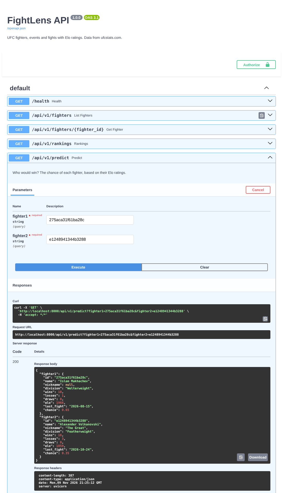

# FightLens API

[](https://github.com/arturMi/fightlens-api/actions/workflows/ci.yml)

A small REST API for UFC fights. It loads every UFC fight since 1994, gives each fighter an
Elo rating and tells you who would probably win if two fighters met.

Built with Python, FastAPI and PostgreSQL, and it runs with Docker. New fights are also written
to a Redis Stream, so other services (search, notifications) can react to them.



## Start

```bash
docker compose up --build
```

Then open http://localhost:8000/docs. On the first start the importer downloads the data
(about 12 MB) and fills the database in a few seconds: 4,628 fighters, 796 events and
8,988 fights.

## Endpoints

| Endpoint | What you get |
| --- | --- |
| `GET /api/v1/fighters?search=&division=` | Fighters, best rating first |
| `GET /api/v1/fighters/{id}` | One fighter with all UFC fights and how the rating changed |
| `GET /api/v1/rankings?division=` | The top fighters who fought in the last two years |
| `GET /api/v1/predict?fighter1=&fighter2=` | Each fighter's chance to win |
| `GET /api/v1/events?year=` | Events, newest first |
| `GET /api/v1/events/{id}` | One event with all its fights |
| `POST /api/v1/import` | Loads the newest data (needs the token from `IMPORT_TOKEN`) |
| `GET /health`, `GET /metrics` | Health check and Prometheus metrics |

```bash
curl "localhost:8000/api/v1/fighters?search=volkanovski"
curl "localhost:8000/api/v1/rankings?division=Lightweight&limit=5"
curl "localhost:8000/api/v1/predict?fighter1=275aca31f61ba28c&fighter2=e1248941344b3288"
```

## How it works

1. `python -m fightlens.importer` downloads the CSV files of the open dataset
   [scrape_ufc_stats](https://github.com/Greco1899/scrape_ufc_stats), which is copied from
   [ufcstats.com](http://ufcstats.com) every day, and saves them in PostgreSQL. Running it twice
   changes nothing, because existing rows are updated instead of added again.
2. Then it goes through all fights from old to new and works out the Elo ratings.
3. Fights that are new are written to the Redis Stream `fightlens:fights`.

**Matching names.** The list of fights only has names, no fighter ids. So the importer looks
the names up, ignoring accents, capital letters and word order. A few names belong to two
people, for example a flyweight and a middleweight called Bruno Silva. Then the weight decides.
If it's still unclear, the fight is saved without the id (6 names right now). No match is
better than a wrong one.

**Elo ratings.** Everybody starts with 1500 points. When you win, you take points from the
loser: a few for beating a weaker fighter, a lot for an upset. The same formula gives the
chance to win:

```
chance that A beats B = 1 / (1 + 10 ^ ((Elo of B - Elo of A) / 400))
```

How good is that? Before every fight between two fighters with at least three fights, the
importer checks if the higher rated one won. That was true for 55.9 % of 3,969 fights. Only a
bit better than a coin flip, because the UFC mostly puts fighters of the same level against
each other. A model that also looks at reach, age and activity would be a good next step.

**New fights for other services.** Each new fight is one entry in the Redis Stream:

```json
{"id": "4e6c304705f82ce0", "event": "UFC Fight Night: Cortes Acosta vs. Walker",
 "date": "2026-11-07", "division": "Heavyweight", "title_fight": false,
 "fighter1_id": "fc08099550072fe4", "fighter1": "Waldo Cortes Acosta",
 "fighter2_id": "c21f26bbde777573", "fighter2": "Johnny Walker",
 "result": "fighter2", "method": "KO/TKO", "round": 3, "time": "2:27"}
```

A fight only counts as sent once Redis has it. If Redis is down, it goes out with the next
import.

## Development

```bash
docker compose up -d db redis        # just PostgreSQL and Redis
uv sync
uv run python -m fightlens.importer
uv run uvicorn fightlens.main:app --reload
uv run pytest                         # uses its own database, fightlens_test
uv run ruff check .
```

The tests use a small made-up dataset in `tests/data` with the tricky cases: a renamed event,
two fighters with the same name, an unknown name, a draw and a no contest. GitHub Actions runs
the tests and checks that the Docker setup starts.

```
fightlens/
  main.py       the endpoints
  models.py     what the endpoints return
  dataset.py    reading and cleaning the CSV files
  importer.py   saving to PostgreSQL and sending new fights to Redis
  elo.py        the Elo ratings
  db.py         database connection
  schema.sql    the tables
```

